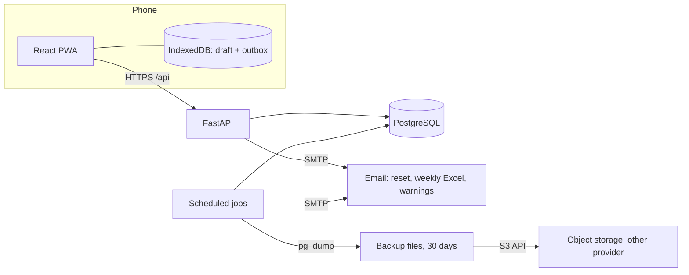

# Hisab: Khata for traders

A mobile-first sales and collection ledger for a wholesale fruit shop in Biratnagar, Nepal.

**Status:** in use. A wholesale fruit trader is using it for his daily ledger, and the interface is being adjusted from his feedback.
**License:** PolyForm Noncommercial 1.0.0. Author: Raghabendra Kumar Shah.

## Live demo

Use the deployed app's login screen with this read-only-for-demo account. It contains three fictional customers and sample fruit sales/payments; please do not enter real data.

- Login: `demo@hisab.app`
- Password: `TryHisab2026!`

## The problem

The owner writes a paper bill, then copies the bill number and total into a paper ledger. The fruit, kg and rate exist only on the slip the customer takes away.
Customers pay in instalments, so balances are typed by hand and drift. The ledger apps he tried record payments but not what was sold to whom.
Hisab records every sale with its fruit lines and every payment, and works out each balance from those records.

## What it does

- One entry form for a sale, a payment, or both. Fruit lines are kg × rate, with an optional crate count. Fruit names and last rates are remembered.
- Customers are created from entries. Similar names are suggested, and an exact match asks "use existing or create separate".
- Customer sheet with the full history in three views (ledger, bills, payments), grouped by BS month, searchable by fruit, bill number or note, with a per-fruit summary.
- Khata home: total to collect, a Today card (bills, sales, money received by cash/eSewa/Khalti/bank, per person), and the customer list sorted by balance.
- Ledger-style customer page: debit is what is still to pay, credit is what was paid. A bill with money paid up front shows both on one line.
- Past entries (owner only): backdate a sale or payment, and add several old bills in a row.
- Corrections: edit or delete a bill or payment, merge or archive a customer, or delete a customer's whole khata (owner only, the name must be typed to confirm). Every delete is written to the audit log first, with a full snapshot.
- Owner and helper logins. A helper can add entries and view customers, and can undo their own entry for 10 minutes. Every entry shows who made it.
- Entries are saved on the phone first and sent when a connection is available. The half-filled form is kept if the app closes.
- English and Nepali, Devanagari digits, Bikram Sambat dates with a BS date picker.
- Excel export of everything, a weekly emailed copy, a daily database backup job that can copy off-site, and a restore check that compares every balance.
- Installable PWA with light and dark themes.

## Key design decisions

- **Balances are derived, never stored.** They are summed from openings, sales, payments and discounts, so they cannot drift from the records.
- **Money is `NUMERIC(14,2)`.** A line is kg × rate rounded half-up to whole rupees. No floating point on the server.
- **Deletes are real, and audited first.** Deleting a bill, payment or customer removes the rows, but the old values are written to `audit_log` before the delete. Older voided rows remain and are excluded from balances. Archive and merge keep all history.
- **Invite-only onboarding.** There is no open self-registration. Access is provisioned via invite links that initialize the shop and trial period, keeping accounts private and managed.
- **Saves are idempotent.** The phone creates a UUID for each entry and the server accepts it once, so a retry after a bad connection cannot duplicate a sale.
- **Failed saves stay on the phone.** A refused entry is kept and flagged with Retry and Discard. It is never dropped silently.
- **BS is displayed, AD is stored.** "Today" and day boundaries follow Nepal time (UTC+05:45).
- **Tenant scoping.** Top-level tables carry `shop_id` and requests filter by it. A test checks that two shops cannot see each other's data.
- **Writes need a custom header.** The API rejects writes without `X-Requested-With`, as a CSRF guard on top of HttpOnly session cookies.

## Architecture



| Layer | Choice | Why |
|---|---|---|
| API | FastAPI, Pydantic v2 | Typed request validation |
| Data | SQLAlchemy 2, Alembic, PostgreSQL | Exact `NUMERIC` money, constraints, safe migrations. SQLite only for development |
| Auth | Session cookie, argon2 | No third-party auth service |
| Frontend | React 18, TypeScript, Vite, `vite-plugin-pwa` | Installable, works as one app |
| Data fetching | TanStack Query | Caching and retries on slow connections |
| On-phone storage | IndexedDB via Dexie | Holds the open form and unsent entries |
| UI | Tailwind CSS, react-i18next | Mobile layout, English/Nepali |
| Dates | `nepali-date-converter` plus a custom picker | The browser date input is AD only |
| Export | `openpyxl` | Builds the Excel workbook |
| Hosting | Docker on Render, PostgreSQL on Neon | Free tiers for the pilot |

In production the API also serves the built frontend, so it is one app on one origin.

## Run locally

```bash
# backend (SQLite is fine for development)
cd backend
pip install -r requirements.txt
export FK_DATABASE_URL=sqlite:///./dev.db
python -m app.cli init-db
python -m app.cli create-shop --name "My Shop" --email you@example.com   # asks for a password
uvicorn app.main:app --reload --port 8000

# frontend, in a second terminal (proxies /api to :8000)
cd frontend
npm install
npm run dev        # http://localhost:5173
```

Settings are environment variables prefixed `FK_`; see `backend/.env.example`.
For PostgreSQL, create the schema with `alembic upgrade head` instead of `init-db`.

## Tests

- `cd backend && pytest` runs the acceptance tests against SQLite. Set `FK_TEST_DATABASE_URL` to run them on PostgreSQL.
- Ledger tests cover: kg × rate rounding half-up, three partial payments, overpayment becoming an advance, a deleted bill or payment changing the balance and leaving an audit snapshot, and a retried save not duplicating.
- Other tests cover helper permission limits, merge, edits being audited, the Excel export matching the app, the weekly email, the restore balance check, the CSRF guard, password reset and shop isolation. Access tests cover invite and trial flows, expired shops becoming read-only, access extensions, and rate limits.
- `cd frontend && npm test` checks BS conversion against an independent Python library (AD 2010–2030, BS month lengths 2070–2086), half-up rounding, Devanagari digit input and name suggestions.
- GitHub Actions runs the backend and frontend checks on every push (`.github/workflows/ci.yml`).
- There are no browser or end-to-end tests.

## Deployment and operations

- The app runs as one Docker web service on Render's free plan, with PostgreSQL on Neon's free plan. The root `Dockerfile` builds the frontend and serves it from the API, `render.yaml` describes the service, and `deploy/render-entrypoint.sh` is the container start script.
- Configuration is by `FK_` environment variables. In production set `FK_DATABASE_URL` and `FK_COOKIE_SECURE=true`.
- Free-tier behaviour: Render's free web service sleeps after 15 minutes without traffic, so the first request after a pause is slow. Neon's free database also suspends when idle and has a short restore window, so keep your own exports (see below).
- The weekly email check runs inside the app every 15 minutes (APScheduler; set `FK_RUN_SCHEDULER=0` to turn it off). On Render's free plan the service sleeps when idle, so an uptime monitor pinging `/api/health` keeps it awake for the schedule. SMTP is configured with `FK_SMTP_HOST`, `FK_SMTP_PORT`, `FK_SMTP_USER`, `FK_SMTP_PASSWORD` and `FK_SMTP_FROM`.
- Other jobs need an external trigger such as cron or another scheduler:
  - `python -m app.jobs backup`: daily `pg_dump`, keeps 30 days, copies to S3-compatible storage if configured, emails the owner on failure.
  - `python -m app.jobs weekly-email`: the same job as the built-in schedule, for running it by hand or from cron.
  - `python -m app.jobs verify-restore --restored-url <url>`: compares every customer balance between live and a restored copy.
- A restore was tested once during development, from a dump into a blank PostgreSQL 16 database, and the balance check passed. Repeat it against the production database every few months.
- `pg_dump` must be installed where the backup job runs.
- The owner can download an Excel export of everything from Settings at any time.

## Limitations and non-goals

- No inventory or stock, no purchase or supplier ledgers, no small consumer buyers. Units are kg only, with crates as a note.
- Customers do not use the app and it sends them nothing. Reminders and bills are handled outside it.
- One shop per account. Two physical shops are not separated. Per-person totals on the Today card are the nearest thing.
- Saving an entry works offline. Editing, deleting, merging and archiving need a connection.
- A deleted customer or entry cannot be restored from the app. The audit log keeps a snapshot, and older Neon backups and weekly emailed copies still contain it.
- Entries queued offline by a shop whose trial has ended are refused (read-only) and stay on the phone as failed.
- Subscription renewals are recorded manually. There is no automated online payment gateway.
- A spoiled-fruit claim can only be handled as a discount. There is no return line.
- The weekly Excel email holds every balance and is not encrypted.
- A bill and the payment taken with it are separate rows, paired by who saved them and when. Later instalments are not tied to specific bills.
- BS dates are not checked against an official calendar. The two converters used here disagree for BS 2087 and the npm one ends at BS 2090.
- Nepali wording has not been reviewed by a native speaker (`frontend/src/locales/ne.ts`).
- Entry speed, first-load time and iPhone Safari behaviour (installed PWA, storage eviction) have not been measured.
- There is no open sign-up page. New shops come from an approved invite (or the CLI), and the owner adds helper accounts in Settings.

## Roadmap

The customer view is being reworked from the owner's feedback on how he keeps and reads each customer's ledger. Further changes follow real use.
Requirements: [docs/requirements.md](docs/requirements.md)

## License and contact

PolyForm Noncommercial 1.0.0, see [LICENSE](LICENSE). Commercial use needs the author's permission.
Contact: [@ragbendra](https://github.com/ragbendra) on GitHub.
